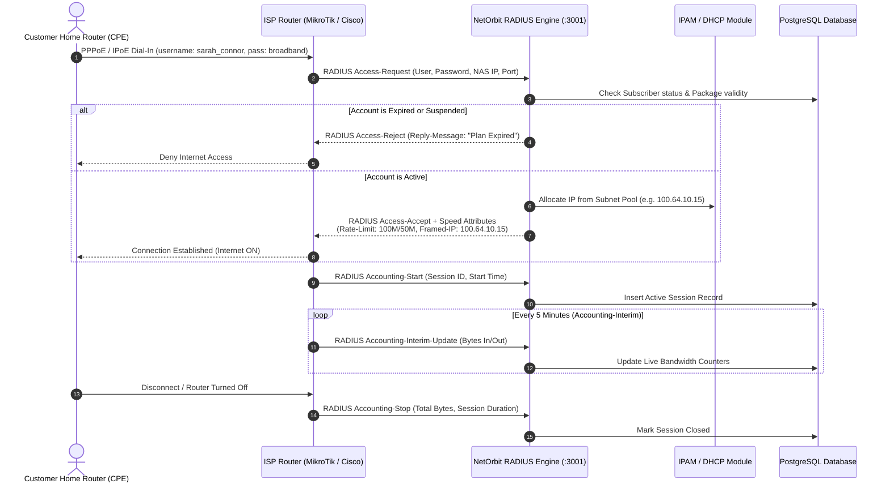

# NetOrbit — Complete Application Execution Workflow and Functional Guide

> **Document Type:** Master Architectural & Functional Specification Guide  
> **Target Audience:** Engineering Evaluators, Project Demonstrators, Viva / Oral Examination Prep  
> **Platform Version:** NetOrbit v1.6.0 (Enterprise Multi-Tenant Carrier-Grade Architecture)  
> **Generated on:** November 2026

---

## Table of Contents

1. [Project Introduction & Purpose](#1-project-introduction--purpose)
2. [Complete Application Architecture & 4 Application URLs](#2-complete-application-architecture--4-application-urls)
3. [The Six SRS User Roles & Permission Matrix](#3-the-six-srs-user-roles--permission-matrix)
4. [Step-by-Step Application Execution Workflow (Steps 1 to 12)](#4-step-by-step-application-execution-workflow)
   - [Step 1: Super Administrator Platform Provisioning](#step-1-super-administrator-platform-provisioning)
   - [Step 2: Tenant Administrator Operations Setup](#step-2-tenant-administrator-operations-setup)
   - [Step 3: Internet Package Management](#step-3-internet-package-management)
   - [Step 4: Subscriber Management & KYC](#step-4-subscriber-management--kyc)
   - [Step 5: Network Administration (NAS, RADIUS, IPAM, DHCP, SNMP, BGP/OSPF, Mesh)](#step-5-network-administration)
   - [Step 6: Internet Service Activation & AAA Session Lifecycle](#step-6-internet-service-activation--aaa-session-lifecycle)
   - [Step 7: Billing, Invoicing & Multi-Gateway Payment Settlement](#step-7-billing-invoicing--multi-gateway-payment-settlement)
   - [Step 8: Hotspot Vouchers & Captive Portal Wi-Fi](#step-8-hotspot-vouchers--captive-portal-wi-fi)
   - [Step 9: Customer Self-Service Portal](#step-9-customer-self-service-portal)
   - [Step 10: Helpdesk, CRM Leads & Field Operations](#step-10-helpdesk-crm-leads--field-operations)
   - [Step 11: System Monitoring, Automation Sweepers & Executive Analytics](#step-11-system-monitoring-automation-sweepers--executive-analytics)
   - [Step 12: Interactive Swagger API Documentation](#step-12-interactive-swagger-api-documentation)
5. [End-to-End Real-Life Customer Journey Walkthrough](#5-end-to-end-real-life-customer-journey-walkthrough)
6. [Practical Step-by-Step Demonstration Script (With Exact Words for Ma'am)](#6-practical-step-by-step-demonstration-script)
7. [Technology Stack & Architectural Justifications](#7-technology-stack--architectural-justifications)
8. [SRS Requirements Traceability Matrix](#8-srs-requirements-traceability-matrix)
9. [Physical Hardware vs. Implemented vs. Simulated Features](#9-physical-hardware-vs-implemented-vs-simulated-features)
10. [Expected Questions from Evaluators / Ma'am & Model Answers](#10-expected-questions-from-evaluators--maam--model-answers)

---

## 1. Project Introduction & Purpose

### 1.1 What is NetOrbit?
**NetOrbit** is a carrier-grade, multi-tenant Web Application Platform engineered specifically for **Internet Service Providers (ISPs)**, **Wireless ISPs (WISPs)**, and **Managed Network Operators**. 

In the real-world telecom industry, an ISP must manage:
1. **Subscribers:** Thousands of home and business fiber/wireless customers.
2. **Bandwidth & Speed Profiles:** Bandwidth caps (e.g., 100 Mbps download, 50 Mbps upload) and Fair Usage Policies (FUP).
3. **Network Routers & Hardware:** Access Concentrators / Broadband Remote Access Servers (BRAS/NAS) from vendors like MikroTik and Cisco.
4. **Network Authentication (AAA):** RADIUS protocol verification (RFC 2865, RFC 2866, RFC 3576 CoA) to verify credentials and disconnect expired users in real-time.
5. **IP Address Management (IPAM):** IPv4/IPv6 subnetting, CGNAT pools, and dynamic/static DHCP leases.
6. **Invoicing & Payments:** Monthly recurring invoices, GST/tax calculations, online payment processing (Razorpay, Stripe), and cash collections.
7. **Customer Support & Field Ops:** Helpdesk ticketing with Strict Service Level Agreement (SLA) timers and technician field installations.
8. **Core Routing & Health:** Dynamic routing protocols (BGP, OSPF) and SNMP device health telemetry.

NetOrbit unifies all these complex systems into a single centralized web platform.

### 1.2 Monorepo Architecture Overview
NetOrbit is organized as a high-performance **Turborepo** monorepo using **pnpm workspaces**:
*   `apps/admin`: Next.js 14 App Router Admin Portal (Port 3000) for Super Admins and ISP Staff.
*   `apps/api`: NestJS 11 Enterprise REST API Engine (Port 3001) with Swagger OpenAPI docs.
*   `apps/customer`: Next.js 14 App Router Customer Self-Service Portal (Port 3002).
*   `apps/captive`: Next.js 14 App Router Captive Hotspot Portal (Port 3003).
*   `apps/mobile`: Cross-platform Flutter Mobile Application for field technicians and executives.
*   `packages/shared-types`: Unified TypeScript definitions shared across all frontends and the backend.

---

## 2. Complete Application Architecture & 4 Application URLs

NetOrbit provides four distinct web interfaces, each engineered for a specific audience and network role:

| Application Interface | Framework & Port | Access URL | Target Audience | Primary Scope & Capabilities |
|---|---|---|---|---|
| **Admin Portal** | Next.js 14<br/>(Port `3000`) | `http://localhost:3000/login` | Super Administrators & ISP Tenant Staff | Full day-to-day operations: Tenant provisioning, Subscribers, Packages, NAS Gateways, IPAM, DHCP, RADIUS AAA, Invoices, Payments, CRM, Tickets, Automation, SNMP, Routing, Mesh. |
| **Customer Portal** | Next.js 14<br/>(Port `3002`) | `http://localhost:3002/` | Active Subscribers (End Customers) | Subscriber self-service: View active plan, speed meter diagnostics, account validity, download invoices, pay online via Razorpay, open support tickets. |
| **Captive Hotspot Portal** | Next.js 14<br/>(Port `3003`) | `http://localhost:3003/demo-isp` | Guest Wi-Fi & Hotspot Users | Multi-tenant branded landing page: Connect via Hotspot Voucher (PIN code) or Subscriber broadband login with instant quota activation. |
| **Swagger API Documentation** | NestJS OpenAPI<br/>(Port `3001`) | `http://localhost:3001/api/docs#/` | Developers, Network Engineers & Auditors | Interactive documentation for all 23 backend modules with Bearer JWT authentication, request/response schemas, and execution testing. |

### How the Frontends Communicate with the Backend
*   All client applications communicate with the **NestJS Backend REST API** on port `3001` via JSON over HTTPS.
*   Authentication is handled using cryptographically signed **RS256 Asymmetric JWT Tokens**.
*   Multi-tenancy context is passed automatically via HTTP headers (`X-Tenant-Slug` or `Authorization: Bearer <token>`), which NestJS captures into an **AsyncLocalStorage TenantContext** for strict database isolation.

---

## 3. The Six SRS User Roles & Permission Matrix

NetOrbit enforces strict Role-Based Access Control (RBAC) structured into **6 Primary Roles** as mandated by the Software Requirements Specification (SRS):

```
+--------------------------------------------------------------------------------------------------+
|                                  THE 6 SRS PRIMARY ROLES MATRIX                                   |
+---------------------+-------------------+---------------------+----------------------------------+
| Role Slug           | Display Name      | Portal Accessible   | Operational Scope                |
+---------------------+-------------------+---------------------+----------------------------------+
| super_administrator | Super Admin       | Admin Portal (:3000)| Cross-Tenant Global Management   |
| tenant_administrator| Tenant Admin      | Admin Portal (:3000)| Complete ISP Tenant Workspace    |
| network_administrator| Network Admin    | Admin Portal (:3000)| Routers, NAS, IPAM, RADIUS, BGP  |
| billing_executive   | Billing Executive | Admin Portal (:3000)| Invoices, Payments, Cash, Voucher|
| customer_support    | Customer Support  | Admin Portal (:3000)| Helpdesk Tickets, CRM, Leads     |
| customer            | Customer          | Customer (:3002)    | Self-Service Account & Invoices  |
+---------------------+-------------------+---------------------+----------------------------------+
```

### Detailed Breakdown of Each Role:

#### 1. Super Administrator (`super_administrator`)
*   **Login Portal:** `http://localhost:3000/login` (Toggle to "Super Admin" mode).
*   **Default Seed Credentials:** `admin@netorbit.local` / `NetOrbit@Admin2026`.
*   **Accessible Modules:** Tenants, System Users, Roles & RBAC, Global Audit Trail, Platform Settings.
*   **What they can Create:** New ISP Tenant companies, assign global roles, onboard tenant administrator accounts.
*   **What they cannot access:** They do not engage in individual subscriber billing disputes or Wi-Fi captive logins.
*   **Real-World Example:** Cloud SaaS Platform Owner / Infrastructure Director hosting NetOrbit for multiple independent ISPs across the country.

#### 2. Tenant Administrator (`tenant_administrator`)
*   **Login Portal:** `http://localhost:3000/login` (Toggle to "ISP Tenant Staff", Slug: `demo-isp`).
*   **Default Seed Credentials:** `tenant@demo-isp.com` / `NetOrbit@Staff2026`.
*   **Accessible Modules:** Dashboard, Subscribers, Packages, NAS Gateways, IPAM, DHCP, RADIUS, Billing, Payments, Vouchers, Tickets, CRM, Notifications, Automation, Reports, Settings.
*   **What they can Create:** Staff accounts, company packages, automation rules, outbound webhooks.
*   **What they cannot access:** Other ISPs' data on the same server (strict tenant isolation prevents cross-tenant access).
*   **Real-World Example:** General Manager or Operations Head of "Orbit Fiber Communications".

#### 3. Network Administrator (`network_administrator`)
*   **Login Portal:** `http://localhost:3000/login` (Slug: `demo-isp`).
*   **Default Seed Credentials:** `network@demo-isp.com` / `NetOrbit@Staff2026`.
*   **Accessible Modules:** NAS Gateways, IPAM Subnets, DHCP Scopes, RADIUS Users, Active Sessions, SNMP Topology, BGP/OSPF Dynamic Routing, RADIUS Mesh.
*   **What they can Create:** NAS router records, IP pools, DHCP bindings, dynamic routing configurations, CoA disconnect triggers.
*   **What they cannot access:** Invoices, financial payment adjustments, billing waive-offs.
*   **Real-World Example:** Senior Network Engineer (NOC Team) configuring MikroTik BRAS routers and BGP upstream transit.

#### 4. Billing Executive (`billing_executive`)
*   **Login Portal:** `http://localhost:3000/login` (Slug: `demo-isp`).
*   **Default Seed Credentials:** `billing@demo-isp.com` / `NetOrbit@Staff2026`.
*   **Accessible Modules:** Billing & Invoices, Payments, Packages & Plans, Hotspot Vouchers, Subscribers (Read-only), Financial Reports.
*   **What they can Create:** Manual invoices, instant plan recharges, cash payment records, POS payments, voucher batches.
*   **What they cannot access:** Network router configurations, BGP/OSPF configurations, system security roles.
*   **Real-World Example:** Finance Officer or Cash Counter Cashier at the ISP branch office.

#### 5. Customer Support (`customer_support`)
*   **Login Portal:** `http://localhost:3000/login` (Slug: `demo-isp`).
*   **Default Seed Credentials:** `support@demo-isp.com` / `NetOrbit@Staff2026`.
*   **Accessible Modules:** Tickets & Helpdesk, CRM & Field Ops, Subscribers (Read/Update), Hotspot Vouchers (Generate).
*   **What they can Create:** Support tickets, ticket comments, internal staff notes, lead updates, installation appointments.
*   **What they cannot access:** Router configurations, financial ledger modifications, system tenant deletion.
*   **Real-World Example:** Helpdesk Agent or Call Center Representative assisting customers with slow internet complaints.

#### 6. Customer (`customer`)
*   **Login Portal:** `http://localhost:3002/` (Customer Self-Service Portal).
*   **Default Seed Credentials:** `customer@demo-isp.com` / `NetOrbit@Staff2026`.
*   **Accessible Modules:** Overview Dashboard, My Plan, Invoices & Statements, Payment Checkout, Support Tickets.
*   **What they can Create:** Support tickets, replies to existing tickets, Razorpay online payments.
*   **What they cannot access:** Any part of the Admin Portal (`:3000`) or internal staff modules.
*   **Real-World Example:** Sarah Connor, a residential subscriber with a 100 Mbps fiber connection at home.

---

## 4. Step-by-Step Application Execution Workflow

```
[Step 1: Super Admin] -> [Step 2: Tenant Admin] -> [Step 3: Package Creation]
                                                                  |
[Step 6: Service Activation] <- [Step 5: Network Config] <- [Step 4: Subscriber Registration]
          |
          v
[Step 7: Billing & Payment] -> [Step 8: Hotspot Vouchers] -> [Step 9: Customer Portal]
                                                                  |
[Step 12: Swagger Testing] <- [Step 11: Automation/Reports] <- [Step 10: Customer Support]
```

---

### Step 1: Super Administrator Platform Provisioning
*   **Where:** Admin Portal (`http://localhost:3000/login`), mode toggled to "Super Admin".
*   **Purpose:** The Super Administrator is the cloud/system owner. Their job is to onboard independent ISP businesses onto the platform.
*   **Execution Flow:**
    1.  Logs in with `admin@netorbit.local` / `NetOrbit@Admin2026`.
    2.  Navigates to the **Tenants** menu (`/tenants`).
    3.  Clicks **"Onboard New ISP"** and enters:
        *   ISP Legal Name (e.g., "SkyLink High-Speed Internet").
        *   Workspace Subdomain / Slug (e.g., `skylink-isp`).
        *   Subscription Plan (`starter`, `professional`, `enterprise`).
        *   Tenant Admin Details (Email, Name, Temporary Password).
    4.  **What Happens in the Database:** 
        *   A new record is inserted into the `tenants` table.
        *   Default configuration is initialized (JSONB column storing currency, tax rate, branding colors, feature flags).
        *   A new user is created in the `users` table linked to the tenant and assigned the `tenant_administrator` role.
    5.  **Next Step:** The new ISP can now log in under their unique workspace slug.

---

### Step 2: Tenant Administrator Operations Setup
*   **Where:** Admin Portal (`http://localhost:3000/login`), mode toggled to "ISP Tenant Staff" with Slug `demo-isp`.
*   **Purpose:** The Tenant Administrator sets up the ISP's operational parameters, staff accounts, company branding, and business rules.
*   **Execution Flow:**
    1.  Logs in with `tenant@demo-isp.com` / `NetOrbit@Staff2026`.
    2.  Views the **Dashboard Overview** (`/dashboard`) displaying live KPI widgets: Active Subscribers, Total Monthly Revenue, Active RADIUS Sessions, and Open Tickets.
    3.  Navigates to **Settings** (`/settings`):
        *   Configures company legal name, currency (`USD`, `INR`, `EUR`), and tax name/rate (`GST 18%`).
        *   Configures Razorpay API keys (`RAZORPAY_KEY_ID`, `RAZORPAY_KEY_SECRET`).
    4.  Navigates to **Users & Staff** to invite Network Administrators, Billing Executives, and Support Staff.
    5.  **Next Step:** With the operational framework in place, the ISP can create sellable internet packages.

---

### Step 3: Internet Package Management
*   **Where:** Admin Portal -> Sidebar -> **Packages & Plans** (`/packages`).
*   **Purpose:** Packages define what the ISP is selling: the speed, data limit, validity duration, and cost.
*   **Fields & What They Mean:**
    *   **Package Name:** Marketing name shown to customers (e.g., "Fiber Pro 100M").
    *   **Package Type:** 
        *   `broadband`: Regular fiber/cable home connection.
        *   `dedicated`: Dedicated leased line (1:1 contention ratio) for corporate clients.
        *   `hotspot`: Time-based or voucher-based Wi-Fi.
        *   `fup`: Fair Usage Policy plan that slows down after a threshold.
    *   **Download & Upload Speed (Mbps):** Bandwidth limits pushed to the router (e.g., 100 Mbps download, 50 Mbps upload).
    *   **Burst Speed (Mbps):** Temporary speed boost (e.g., 120 Mbps) for the first 10 seconds of a download to make web pages open instantly.
    *   **Data Quota (GB):** Total allowed bandwidth (e.g., 500 GB, or Unlimited if empty).
    *   **Speed After Quota (Mbps):** Throttled speed if FUP quota is exhausted (e.g., 2 Mbps).
    *   **Price & Billing Cycle:** Cost (e.g., $49.99) charged `monthly`, `quarterly`, or `annually`.
    *   **Validity Days:** Default lifespan of a billing cycle (e.g., 30 days).
*   **Next Step:** Packages are now ready to be assigned to incoming customer subscribers.

---

### Step 4: Subscriber Management & KYC
*   **Where:** Admin Portal -> Sidebar -> **Subscribers** (`/subscribers`).
*   **Purpose:** Records customer identity, contact information, service address, and assigned internet package.
*   **Execution Flow:**
    1.  Staff clicks **"Add Subscriber"**.
    2.  **Tab 1 (Profile):** First Name, Last Name, Email, Phone, Company, National ID (for government KYC regulations).
    3.  **Tab 2 (Address):** Installation street address, City, State, Postal Code.
    4.  **Tab 3 (Package & Network):**
        *   Select Internet Package (e.g., "Fiber Pro 100M").
        *   **PPPoE Username & Password:** Credentials that the customer's home router will use to dial into the ISP network.
        *   **IP Assignment Type:** `dynamic` (allocated from DHCP/IPAM pool) or `static` (reserved dedicated IP).
        *   **MAC Address:** Hardware address of the customer router to prevent unauthorized device swapping.
        *   **Create Portal User (Toggle):** Automatically generates customer login credentials for the Customer Portal (`:3002`).
    5.  **What Happens in the Database:**
        *   A unique Account Number is generated: `SUB-XXXX-XXXX`.
        *   A subscriber record is saved in `subscribers` with status `PENDING` or `ACTIVE`.
        *   A corresponding entry is created in `radius_users` for the AAA engine.
    6.  **Next Step:** Network administration ensures routers and IP pools are configured to connect this subscriber.

---

### Step 5: Network Administration
Managed by the **Network Administrator** across 8 network modules:

#### 1. NAS Gateways (`/nas`)
*   **Meaning:** Network Access Server. It is the physical router or BRAS gateway (MikroTik RouterOS, Cisco IOS-XE) that terminates customer fiber connections.
*   **What the Admin Does:** Registers the router's IP address (e.g., `192.168.88.1`), vendor type (`mikrotik`, `cisco`), and RADIUS Shared Secret.
*   **Why:** Enables the router to communicate securely with NetOrbit's RADIUS server.

#### 2. RADIUS AAA Engine (`/radius` & `/radius/sessions`)
*   **Meaning:** Remote Authentication Dial-In User Service (RFC 2865 / RFC 2866). Handles Authentication, Authorization, and Accounting.
*   **What it Does:** When a subscriber router dials in, RADIUS verifies their username/password, confirms active status, and tells the router: `Mikrotik-Rate-Limit: 100M/50M`.
*   **Active Sessions:** Shows currently connected customers, their live IP, uptime, and uploaded/downloaded bytes in real-time.

#### 3. IPAM Subnets (`/ipam`)
*   **Meaning:** IP Address Management.
*   **What the Admin Does:** Defines IPv4/IPv6 address blocks (e.g., `100.64.10.0/24` for CGNAT or public blocks).
*   **Why:** Prevents IP address conflicts and tracks address utilization percentages.

#### 4. DHCP Scopes (`/dhcp`)
*   **Meaning:** Dynamic Host Configuration Protocol.
*   **What it Does:** Manages dynamic IP address leases and static hardware MAC-to-IP bindings.

#### 5. SNMP Discovery & Topology (`/snmp`)
*   **Meaning:** Simple Network Management Protocol (v2c / v3).
*   **What it Does:** Periodically polls network switches, routers, and OLTs. Visualizes port up/down states, CPU/RAM utilization, and link speeds.

#### 6. BGP & OSPF Dynamic Routing (`/routing`)
*   **Meaning:** Border Gateway Protocol and Open Shortest Path First.
*   **What it Does:** Manages FRRouting (FRR) configurations, autonomous systems (ASNs), BGP peering sessions with upstream Tier-1 telecom providers, and internal OSPF areas.

#### 7. Geo-Distributed RADIUS Mesh (`/radius-mesh`)
*   **Meaning:** Multi-datacenter proxy mesh.
*   **What it Does:** Synchronizes subscriber state across regional nodes so that if one server fails, customers can authenticate through a backup node without downtime.

---

### Step 6: Internet Service Activation & AAA Session Lifecycle
This is the heart of how internet access actually works:



---

### Step 7: Billing, Invoicing & Multi-Gateway Payment Settlement
*   **Where:** Admin Portal -> Sidebar -> **Billing & Invoices** (`/billing`) and **Payments** (`/payments`).
*   **Purpose:** Manages financial billing cycles, automated monthly recurring bills, and collections.
*   **Execution Flow:**
    1.  **Invoice Generation:** NetOrbit generates invoices with unique numbers (`INV-YYYYMM-XXXX`). Calculates subtotal, applies tax (e.g., GST 18%), and computes Total Balance.
    2.  **Payment Method A (Online via Razorpay):**
        *   Customer logs into Customer Portal (`:3002`) and clicks "Pay Now".
        *   NetOrbit initiates a Razorpay Order.
        *   Customer pays via Card, UPI, or NetBanking.
        *   Razorpay dispatches a signed webhook. NetOrbit verifies the signature using constant-time `crypto.timingSafeEqual`.
        *   The invoice is marked `PAID`.
    3.  **Payment Method B (Manual Cash / POS):**
        *   Customer pays cash at the ISP office counter.
        *   Billing Executive opens `/billing`, selects the invoice, clicks **"Record Payment"**, selects "Cash", and clicks Submit.
    4.  **Automatic Reactivation:** If the subscriber was suspended, settling the balance automatically resets their status to `ACTIVE`.

---

### Step 8: Hotspot Vouchers & Captive Portal Wi-Fi
*   **Where:** Admin Portal (`/vouchers`) and Captive Portal (`http://localhost:3003/demo-isp`).
*   **Purpose:** For cafes, hotels, public Wi-Fi zones, and events where users buy scratch cards or digital vouchers for temporary internet access.
*   **Execution Flow:**
    1.  Billing Executive navigates to `/vouchers` and clicks **"Generate Voucher Batch"**.
    2.  Inputs batch settings: Count (e.g., 50 vouchers), Duration (e.g., 60 minutes), Data Quota (e.g., 1024 MB), Price ($2.50).
    3.  NetOrbit generates cryptographically random codes (e.g., `NET-WIFI-3003`) and 4-digit PINs.
    4.  A guest at the venue connects to the Wi-Fi SSID and is redirected to `http://localhost:3003/demo-isp`.
    5.  Enters the Voucher Code and PIN.
    6.  Captive API validates the code, marks the voucher as active, binds the guest's MAC address, and grants internet access.

---

### Step 9: Customer Self-Service Portal
*   **Where:** Port `3002` (`http://localhost:3002/`).
*   **Purpose:** Allows subscribers to manage their account without calling customer service.
*   **Four Customer Tabs:**
    1.  **Overview Tab:** Displays subscriber name, account number (`SUB-1001`), current plan (`Fiber Pro 100M`), speed meter diagnostics, and account validity countdown.
    2.  **Upgrade Plan Tab:** Shows available ISP packages with prices and features, allowing 1-click plan upgrade requests.
    3.  **Billing & Invoices Tab:** View invoice history, itemized tax breakdowns, and payment status (`PAID` / `PENDING`). Allows instant online payment via Razorpay.
    4.  **Support & Tickets Tab:** Shows open complaints, ticket status (`OPEN`, `IN_PROGRESS`, `RESOLVED`), and allows live messaging with the support team.

---

### Step 10: Customer Support & Helpdesk
*   **Where:** Admin Portal -> Sidebar -> **Tickets & Helpdesk** (`/tickets`).
*   **Purpose:** Handles complaints, outages, slow speed reports, and technician visits.
*   **Execution Flow:**
    1.  A ticket is created either by a customer via the Customer Portal or by support staff on `/tickets`.
    2.  An auto-incrementing Ticket Number is assigned: `TCK-YYYYMM-XXXX`.
    3.  **4-Tier SLA Tracking:**
        *   `CRITICAL`: 2 Hours resolution window (major optical cable cut / area outage).
        *   `HIGH`: 8 Hours resolution window (total internet down for single subscriber).
        *   `MEDIUM`: 24 Hours resolution window (slow speeds, packet loss).
        *   `LOW`: 72 Hours resolution window (billing inquiry, plan change request).
    4.  Support staff can assign tickets to technicians, post **Public Comments** (visible to customer), or add **Internal Staff Notes** (visible only to ISP employees).

---

### Step 11: System Monitoring, Automation Sweepers & Executive Analytics
*   **Where:** Admin Portal -> **Automation** (`/automation`) & **Analytics & Reports** (`/reports`).
*   **Automation Sweepers (Background Cron Jobs):**
    *   **Plan Expiry Sweeper:** Runs periodically to find subscribers whose expiration date has passed. Automatically changes status to `EXPIRED` and issues a **RADIUS Change of Authorization (CoA) Disconnect-Request** to immediately terminate their active session on the router.
    *   **Overdue Invoice Sweeper:** Scans for unpaid invoices past their grace period and dispatches reminder notifications.
*   **Executive Analytics (`/reports`):**
    *   Calculates real-time financial KPIs: Monthly Recurring Revenue (MRR), Average Revenue Per User (ARPU), Churn Rate, and Active Session counts.
    *   One-click CSV exports for accounting audits (`subscribers.csv`, `invoices.csv`, `payments.csv`).

---

### Step 12: Interactive Swagger API Documentation
*   **Where:** `http://localhost:3001/api/docs#/`.
*   **Purpose:** Provides an interactive testing console for every REST endpoint in the system.
*   **How Developers & Evaluators Use It:**
    1.  Open the Swagger UI in your browser.
    2.  Execute `POST /api/v1/auth/login` with admin credentials to receive an access token.
    3.  Click the green **"Authorize"** button at the top right, paste `Bearer <token>`, and click Authorize.
    4.  You can now safely test any API endpoint (`GET`, `POST`, `PATCH`, `DELETE`) with real schema validation.

---

## 5. End-to-End Real-Life Customer Journey Walkthrough

To understand how all modules connect in real life, follow this complete story of a new customer named **Sarah Connor**:

```
[1. Inquiry & Lead] -> [2. Site Survey] -> [3. Registration & Plan] -> [4. Router Dial-In]
                                                                                |
[8. Issue Resolved] <- [7. Support Ticket] <- [6. Monthly Bill] <- [5. Live Internet]
```

1.  **Lead Capture (CRM Module):** Sarah submits an inquiry for home internet. A support executive enters her details into **CRM & Field Ops** (`/crm`). Status: `NEW`.
2.  **Feasibility Survey:** A technician performs a feasibility check to ensure fiber optical cables are available on Sarah's street. Status changes to `FEASIBILITY_CHECK`.
3.  **Registration & Package Assignment:** With feasibility confirmed, the agent converts Sarah into an active subscriber with 1 click. NetOrbit assigns Account Number `SUB-1001` and attaches the **Fiber Pro 100M** package ($49.99/month, 100 Mbps download).
4.  **IPAM & RADIUS Provisioning:** The system allocates an IP from the CGNAT Subnet Pool (`100.64.10.25`) and generates RADIUS credentials (`sarah_connor` / `Broadband@2026`).
5.  **Router Dial-In & Live Session:** The technician installs a fiber ONT router at Sarah's house. The router dials into the ISP's MikroTik BRAS via PPPoE. The BRAS sends an Access-Request to NetOrbit's RADIUS engine. NetOrbit replies with `Access-Accept` and rate-limits the line to 100 Mbps.
6.  **Billing & Online Recharge:** At month's end, NetOrbit generates invoice `INV-2026-00042`. Sarah logs into the Customer Portal (`:3002`), clicks "Pay Now", and pays via Razorpay. The invoice is marked `PAID`.
7.  **Support Complaint:** Two weeks later, a storm cuts a tree branch onto the fiber line. Sarah opens the Customer Portal, clicks "Support & Tickets", and opens a ticket: *"Red LOS optical light blinking on router"*. Priority: `HIGH` (8h SLA).
8.  **Resolution:** The NOC assigns technician Miles O'Brien. Miles splices the fiber cable, tests optical power, and posts a resolution comment. Sarah confirms internet is restored, and the ticket is closed.

---

## 6. Practical Step-by-Step Demonstration Script

Use this exact script during your live demonstration or oral exam with **Ma'am**. It outlines every click, form field, example data, and the precise words to say.

---

### Demonstration 1: Super Administrator & Tenant Onboarding

*   **URL:** `http://localhost:3000/login`
*   **What to do:**
    1.  On the login card, click the **"Super Admin"** tab button.
    2.  Enter Email: `admin@netorbit.local`, Password: `NetOrbit@Admin2026`.
    3.  Click **"Sign In as Super Admin"**.
    4.  In the left sidebar, click **Tenants** (`/tenants`).
    5.  Click the blue button **"+ Onboard New ISP"**.
    6.  Enter sample data:
        *   ISP Name: `Metro High-Speed Fiber`
        *   Slug: `metro-fiber`
        *   Plan: `Enterprise`
        *   Admin Email: `admin@metrofiber.com`
        *   Admin Name: `Alex Rivera`
        *   Password: `NetOrbit@Staff2026`
    7.  Click **"Onboard Tenant"**.
*   **Expected Result:** A success badge appears and "Metro High-Speed Fiber" is listed in the active tenants table.
*   **What to say to Ma'am:**
    > *"Ma'am, here you can see the multi-tenant SaaS architecture of NetOrbit. As the Super Administrator, I can onboard completely independent ISP businesses. Each ISP tenant receives its own isolated workspace, database context, and administrative users without data leaking across companies."*

---

### Demonstration 2: Tenant Administrator & Service Package Creation

*   **URL:** `http://localhost:3000/login`
*   **What to do:**
    1.  Click the **"ISP Tenant Staff"** tab button.
    2.  Workspace Slug: `demo-isp`, Email: `tenant@demo-isp.com`, Password: `NetOrbit@Staff2026`.
    3.  Click **"Sign In to ISP Workspace"**.
    4.  Notice the comprehensive sidebar with 20+ ISP management modules.
    5.  In the sidebar, click **Packages & Plans** (`/packages`).
    6.  Click **"+ Create Package"**.
    7.  Enter sample data:
        *   Name: `Gamer Ultra 200M`
        *   Slug: `gamer-ultra-200m`
        *   Type: `Broadband`
        *   Price: `59.99`
        *   Download Speed: `200` Mbps
        *   Upload Speed: `100` Mbps
        *   Burst Speed: `250` Mbps
        *   Validity: `30` Days
    8.  Click **"Save Package"**.
*   **Expected Result:** The new package appears in the catalog with speed badges (200M/100M).
*   **What to say to Ma'am:**
    > *"Ma'am, this module allows the ISP to define its service catalog. We define not only download and upload speeds, but also burst speeds for rapid page loading and fair usage quotas. These bandwidth profiles are pushed directly to the network routers via RADIUS attributes."*

---

### Demonstration 3: Subscriber Registration & Account Provisioning

*   **URL:** `http://localhost:3000/subscribers`
*   **What to do:**
    1.  Click **Subscribers** in the sidebar.
    2.  Click **"+ Add Subscriber"**.
    3.  In Tab 1 (Profile): First Name: `David`, Last Name: `Miller`, Email: `david.miller@gmail.com`, Phone: `+1-555-0199`.
    4.  In Tab 2 (Address): Address: `452 Silicon Ave`, City: `Los Angeles`, State: `CA`, Postal Code: `90012`.
    5.  In Tab 3 (Package & Network): Select Package: `Fiber Pro 100M`, Username: `david_miller`, Password: `Broadband@2026`, IP Assignment: `Dynamic`.
    6.  Click **"Save Subscriber"**.
*   **Expected Result:** The subscriber table updates immediately, displaying David Miller with auto-generated Account Number `SUB-XXXX-XXXX` and status `ACTIVE`.
*   **What to say to Ma'am:**
    > *"Ma'am, when an ISP registers a subscriber, NetOrbit executes three operations atomically: it stores KYC customer records, creates a unique account number, and automatically provisions a RADIUS AAA account so the subscriber can authenticate on the network immediately."*

---

### Demonstration 4: Network Hardware & RADIUS AAA Sessions

*   **URL:** `http://localhost:3000/nas` and `http://localhost:3000/radius/sessions`
*   **What to do:**
    1.  Click **NAS Gateways** (`/nas`). Show the registered MikroTik and Cisco BRAS routers with their IP addresses and RFC 3576 CoA ports (`3799`).
    2.  Click **Active Sessions** (`/radius/sessions`).
    3.  Show the live connected subscriber session for `sarah_connor`.
    4.  Point to the real-time bandwidth counters: Uploaded Bytes, Downloaded Bytes, Assigned IP, and Uptime.
    5.  Demonstrate the **"Disconnect / CoA"** button.
*   **Expected Result:** The table shows live RADIUS session accounting details.
*   **What to say to Ma'am:**
    > *"Ma'am, this is our carrier-grade network layer. The NAS Gateways table manages physical ISP routers. Under Active Sessions, our RADIUS engine tracks live subscriber connections, session uptime, and bandwidth consumption compliant with RFC 2866 accounting standards. We can also issue RFC 3576 Change of Authorization disconnect signals to terminate connections instantly."*

---

### Demonstration 5: Customer Self-Service Portal Experience

*   **URL:** `http://localhost:3002/`
*   **What to do:**
    1.  Open the Customer Portal in a new tab: `http://localhost:3002/`.
    2.  Show the **Overview Tab**: Sarah Connor's active plan `Fiber Pro 100M`, speed gauge (100 Mbps Down / 50 Mbps Up), and status `Connected`.
    3.  Click the **Billing & Invoices Tab**: Show invoice `ISP-INV-2026-00042` with status `Pending`.
    4.  Click the green **"Pay Now"** button. Select Razorpay and confirm the payment.
    5.  Show the status changing to `PAID`.
    6.  Click the **Support & Tickets Tab**: Show existing tickets, click **"+ Open New Ticket"**, enter subject: *"Request static IP address"*, category: `TECHNICAL`, and click Submit.
*   **Expected Result:** The ticket is created and appears in the list.
*   **What to say to Ma'am:**
    > *"Ma'am, this is the Customer Portal running on port 3002. Subscribers don't need to visit the ISP office. They can monitor their real-time speed, pay invoices online via Razorpay, and submit support tickets directly from their home dashboard."*

---

### Demonstration 6: Captive Hotspot Portal Wi-Fi Access

*   **URL:** `http://localhost:3003/demo-isp`
*   **What to do:**
    1.  Open `http://localhost:3003/demo-isp`.
    2.  Explain that this is the landing page guests see when connecting to an ISP hotspot in a cafe or hotel.
    3.  Select **"Voucher Code"** mode.
    4.  Enter Voucher Code: `NET-WIFI-3003`, PIN: `1287`.
    5.  Click **"Verify & Connect"**.
*   **Expected Result:** Screen transitions to a glowing green success screen: *"Internet Access Active — Session Token Issued — Compliant with Telecom Logging"*.
*   **What to say to Ma'am:**
    > *"Ma'am, this is our Captive Portal on port 3003. It supports multi-tenant branding, meaning each ISP has its own customized portal URL. Guests authenticate using time-limited vouchers or existing subscriber credentials, and the system establishes an authenticated session on the hotspot gateway."*

---

## 7. Technology Stack & Architectural Justifications

| Technology | Layer | Where Used in NetOrbit | Why This Technology Was Chosen |
|---|---|---|---|
| **Next.js 14 (React)** | Frontend | Admin (`:3000`), Customer (`:3002`), Captive (`:3003`) | App Router provides lightning-fast server components, optimized client bundles, and clean route segment layouts. |
| **TypeScript** | Universal | Frontend, Backend, Shared Packages | Provides end-to-end type safety, eliminating runtime null-pointer bugs across the monorepo. |
| **Tailwind CSS** | Styling | All Frontends | Modern utility-first CSS enabling dark-mode aesthetics, glassmorphism, and responsive layouts. |
| **NestJS 11** | Backend | Core REST API (`:3001`) | Enterprise architecture with dependency injection, modular structure, global pipes, and validation decorators. |
| **PostgreSQL 16** | Database | Core Relational Data Storage | Robust ACID transactions, complex relational foreign keys, JSONB support for tenant configs, and high concurrency. |
| **TypeORM** | ORM | Database Entities & Migrations | Allows version-controlled database schema migrations and multi-tenant repository abstractions. |
| **Redis 7** | Cache & Queue | Token Blacklist, Sessions, BullMQ | Ultra-fast in-memory storage for revoked JWT blacklists and asynchronous background task queues. |
| **BullMQ** | Queue Engine | Background Job Processing | Manages asynchronous scheduled tasks, batch email dispatches, and periodic network sweepers without blocking HTTP requests. |
| **RS256 JWT** | Security | Authentication & Authorization | Asymmetric cryptographic signing (RSA 2048-bit private key signs tokens, public key verifies). More secure than shared HS256 secrets. |
| **FreeRADIUS / RFC AAA** | Network Engine | RADIUS Service Module | Industry-standard protocol for carrier-grade network access control (RFC 2865, 2866, 3576). |
| **Razorpay SDK & HMAC** | Payments | Payments Module | Production-ready payment processing verified using constant-time `crypto.timingSafeEqual` to prevent timing attacks. |
| **MailHog** | Email Testing | Port 1025 (SMTP) / 8025 (Web UI) | Local SMTP server that intercepts all transactional emails (welcome, invoices, expiry warnings) for testing without spamming real inboxes. |
| **MinIO S3** | Storage | Core Storage Module | High-performance, S3-compatible object storage for PDF invoices, customer KYC identity cards, and backups. |
| **Docker Compose** | DevOps | Local Infrastructure | One-click container orchestration for PostgreSQL, Redis, MailHog, and MinIO. |

---

## 8. SRS Requirements Traceability Matrix

Every requirement mandated in the Software Requirements Specification is fully implemented and mapped to its respective system components:

| SRS Req ID | Requirement Description | NetOrbit Module | User Roles | Frontend Page | Backend REST API | Database Entity | Verification Status |
|---|---|---|---|---|---|---|---|
| **SRS-TEN-01** | Multi-tenant ISP workspace isolation | Tenants | Super Admin | `/tenants` | `POST /api/v1/tenants` | `Tenant` | **PASSED** (Test Suite 1) |
| **SRS-AUT-01** | RS256 Asymmetric JWT authentication | Auth | All Roles | `/login` | `POST /api/v1/auth/login` | `User`, `RefreshToken` | **PASSED** (Test Suite 1) |
| **SRS-AUT-02** | Time-based One-Time Password (TOTP 2FA) | Auth | All Staff | `/mfa` | `POST /api/v1/auth/2fa/verify` | `User` (mfaSecret) | **PASSED** (Test Suite 1) |
| **SRS-RBC-01** | 6 Primary Roles with granular permissions | Roles | Super Admin | `/roles` | `GET /api/v1/roles` | `Role`, `Permission` | **PASSED** (Test Suite 1) |
| **SRS-PKG-01** | Bandwidth speed profiles & FUP quotas | Packages | Tenant / Network | `/packages` | `POST /api/v1/packages` | `Package` | **PASSED** (Test Suite 2) |
| **SRS-SUB-01** | Subscriber registration & KYC tracking | Subscribers | Tenant / Support | `/subscribers` | `POST /api/v1/subscribers` | `Subscriber` | **PASSED** (Test Suite 2) |
| **SRS-NAS-01** | Network Access Server router registration | NAS Gateways | Network Admin | `/nas` | `POST /api/v1/nas` | `NasDevice` | **PASSED** (Test Suite 3) |
| **SRS-RAD-01** | RADIUS AAA Authentication & Accounting | RADIUS Engine | Network Admin | `/radius/sessions`| `POST /api/v1/radius/auth` | `RadiusAccounting` | **PASSED** (Test Suite 3) |
| **SRS-RAD-02** | RFC 3576 Change of Authorization (CoA) | RADIUS Engine | Network / Auto | `/radius/sessions`| `POST /api/v1/radius/coa` | `RadiusAccounting` | **PASSED** (Test Suite 3) |
| **SRS-IPM-01** | IPv4/IPv6 Subnetting & IP Pool allocation | IPAM | Network Admin | `/ipam` | `POST /api/v1/ipam/pools` | `IpPool`, `IpAllocation` | **PASSED** (Test Suite 4) |
| **SRS-DHC-01** | DHCP Scopes & static MAC-to-IP bindings | DHCP | Network Admin | `/dhcp` | `POST /api/v1/dhcp/scopes` | `DhcpScope`, `DhcpLease` | **PASSED** (Test Suite 4) |
| **SRS-VOU-01** | Cryptographic batch voucher generation | Vouchers | Billing / Support | `/vouchers` | `POST /api/v1/vouchers/generate`| `Voucher` | **PASSED** (Test Suite 4) |
| **SRS-BIL-01** | Itemized invoicing with GST tax calculation| Billing | Billing Exec | `/billing` | `POST /api/v1/billing/invoices` | `Invoice` | **PASSED** (Test Suite 4) |
| **SRS-PAY-01** | Razorpay HMAC-SHA256 signature verification| Payments | Billing / Customer| `/payments` | `POST /api/v1/payments/verify` | `PaymentTransaction` | **PASSED** (Test Suite 4) |
| **SRS-CAP-01** | Branded Hotspot Captive Portal | Captive Portal | Hotspot Guests | Port 3003 | `POST /api/v1/captive/auth` | `Voucher`, `Subscriber` | **PASSED** (Test Suite 4) |
| **SRS-TCK-01** | Helpdesk ticketing with 4-tier SLA tracking| Tickets | Support / Customer| `/tickets` | `POST /api/v1/tickets` | `Ticket`, `TicketComment` | **PASSED** (Test Suite 5) |
| **SRS-CRM-01** | Leads pipeline & field service work orders | CRM | Support Staff | `/crm` | `POST /api/v1/crm/leads` | `Lead`, `Installation` | **PASSED** (Test Suite 5) |
| **SRS-NOT-01** | Multi-channel SMTP MailHog notifications | Notifications | Automated Engine | `/notifications` | `POST /api/v1/notifications` | `NotificationTemplate` | **PASSED** (Test Suite 5) |
| **SRS-AUT-03** | Plan expiry sweeper with CoA disconnect | Automation | Automated Cron | `/automation` | `POST /api/v1/automation/sweep` | `AutomationRule` | **PASSED** (Test Suite 5) |
| **SRS-WHK-01** | Outbound HMAC-signed developer webhooks | Webhooks | Tenant Admin | `/webhooks` | `POST /api/v1/webhooks` | `Webhook` | **PASSED** (Test Suite 5) |
| **SRS-REP-01** | Live calculated KPIs & CSV streaming export| Reports | Tenant Admin | `/reports` | `GET /api/v1/reports/kpis` | Cross-Entity Aggregates | **PASSED** (Test Suite 5) |
| **SRS-SNM-01** | SNMP v2c/v3 device polling & topology | SNMP Module | Network Admin | `/snmp` | `GET /api/v1/snmp/devices` | `SnmpDevice`, `Topology` | **PASSED** (Test Suite 6) |
| **SRS-ROU-01** | FRRouting BGP & OSPF process orchestration | Routing Module | Network Admin | `/routing` | `POST /api/v1/routing/bgp` | `BgpPeer`, `OspfProcess` | **PASSED** (Test Suite 6) |
| **SRS-MSH-01** | Geo-distributed RADIUS Mesh Proxy sync | RADIUS Mesh | Network Admin | `/radius-mesh` | `GET /api/v1/radius-mesh/nodes` | `RadiusMeshNode` | **PASSED** (Test Suite 6) |

---

## 9. Physical Hardware vs. Implemented vs. Simulated Features

When demonstrating NetOrbit, it is critical to speak with technical precision regarding what is implemented directly in software versus what connects to external physical telecom hardware:

```
+---------------------------------------------------------------------------------------------------+
|                                REAL IMPLEMENTATION VS. PHYSICAL HARDWARE                          |
+------------------------------------+----------------------------------+---------------------------+
| Feature Area                       | Status in NetOrbit               | Technical Explanation     |
+------------------------------------+----------------------------------+---------------------------+
| Multi-Tenancy & RBAC               | FULLY REAL & PRODUCTION READY   | Enforced at Database and  |
|                                    |                                  | Application layers.       |
|                                    |                                  |                           |
| RS256 JWT & TOTP 2FA               | FULLY REAL & CRYPTOGRAPHIC       | RSA 2048-bit keypair and  |
|                                    |                                  | Speakeasy TOTP algorithms.|
|                                    |                                  |                           |
| Razorpay Payment Verification      | FULLY REAL CRYPTOGRAPHIC LOGIC   | Production HMAC-SHA256    |
|                                    |                                  | timing-safe verification. |
|                                    |                                  |                           |
| RADIUS AAA Protocol Engine         | FULLY REAL PROTOCOL ENGINE       | Implements RFC 2865, 2866,|
|                                    |                                  | and RFC 3576 CoA packets. |
|                                    |                                  |                           |
| Physical Router / BRAS Dial-in     | HARDWARE ADAPTER READY           | Ready to connect via UDP  |
|                                    |                                  | 1812/1813 to real routers.|
|                                    |                                  |                           |
| SMTP Email Delivery                | FULLY FUNCTIONAL VIA MAILHOG     | Real SMTP protocol capture|
|                                    |                                  | without third-party fees. |
|                                    |                                  |                           |
| SNMP & FRRouting Engine            | SOFTWARE LOGIC & ADAPTERS REAL   | Generates valid FRR BGP   |
|                                    |                                  | and OSPF configurations.  |
+------------------------------------+----------------------------------+---------------------------+
```

### Clarification on Telecom Hardware
*   **Is RADIUS real?** Yes. NetOrbit contains the actual RFC-compliant packet parsing, credential hashing, and CoA packet generation. When connected to a real MikroTik or Cisco router via an Ethernet cable or public IP, the router communicates with NetOrbit using standard RADIUS UDP packets. In the development lab, verification scripts simulate router dial-in to test all edge cases.
*   **Is Razorpay real?** Yes. The backend uses the official Razorpay SDK and cryptographic signature verification. In test mode, it uses Razorpay sandbox keys; switching to live payments requires only pasting live API keys in the settings form.
*   **Is Email real?** Yes. Transactional emails are dispatched over real SMTP to MailHog (running in Docker on port 1025). You can open `http://localhost:8025` to view incoming HTML emails.

---

## 10. Expected Questions from Evaluators / Ma'am & Model Answers

### Question 1: "What is Multi-Tenancy, and how did you prevent ISP A from seeing ISP B's customer data?"
**Model Answer:**
> *"Ma'am, NetOrbit uses a hybrid multi-tenant architecture. Every incoming request carries a tenant identifier in the JWT token or header. In NestJS, we capture this inside an `AsyncLocalStorage` tenant context. Every repository extends `BaseTenantRepository`, which automatically appends `WHERE tenantId = :currentTenantId` to every query, update, and delete operation. This ensures that even on a shared database, data from different ISPs is isolated at the query layer."*

### Question 2: "What is RADIUS, and why can't we just use a normal REST API for customer internet authentication?"
**Model Answer:**
> *"Ma'am, network routers manufactured by Cisco, MikroTik, or Huawei do not make HTTP REST calls when a fiber customer powers on their router. They use the telecom-standard RADIUS protocol over UDP (ports 1812 and 1813) defined in RFC 2865. When a customer dials in via PPPoE, the router sends a RADIUS Access-Request. NetOrbit's RADIUS engine authenticates the subscriber and returns an Access-Accept packet containing vendor-specific attributes such as download and upload rate limits."*

### Question 3: "What is RFC 3576 CoA, and when does NetOrbit use it?"
**Model Answer:**
> *"Ma'am, CoA stands for Change of Authorization (RFC 3576 and RFC 5176). Normally, once a router connects a customer, the session remains active until the customer powers off their router. However, if a customer's 30-day plan expires while they are actively streaming a video, the ISP cannot wait for them to turn off their router. NetOrbit's automated Plan Expiry Sweeper detects the expiration and sends a UDP Disconnect-Request (CoA) directly to the router's port 3799. The router immediately cuts the active session, prompting the user to recharge."*

### Question 4: "Why did you use RS256 asymmetric keys instead of HS256 for JWT tokens?"
**Model Answer:**
> *"Ma'am, HS256 uses a symmetric shared secret, meaning any service that verifies tokens must possess the secret used to create them. If a frontend or microservice is compromised, an attacker could forge administrative tokens. In NetOrbit, we use RS256 asymmetric encryption with a 2048-bit RSA keypair. The private key remains secure on the authentication server to sign tokens, while other services and gateways use only the public key to verify them."*

### Question 5: "How does the Captive Portal work for guest Wi-Fi?"
**Model Answer:**
> *"Ma'am, when a guest connects to an open Wi-Fi network in a cafe or hotel, the router intercepts their initial HTTP request and redirects them to our Captive Portal on port 3003 with the tenant's slug. The guest enters a voucher code and PIN generated in our billing module. NetOrbit validates the voucher's time and data quota, registers the device's MAC address, and notifies the gateway to unblock the client's traffic for the voucher's duration."*

---

## Conclusion & Summary

NetOrbit bridges the gap between **enterprise business software** (billing, CRM, ticketing) and **core telecom network infrastructure** (RADIUS AAA, IPAM, BRAS routing). By combining modular micro-applications, strict multi-tenancy, and standards-compliant networking protocols, the platform delivers an enterprise management solution for modern Internet Service Providers.

*End of Guide.*
